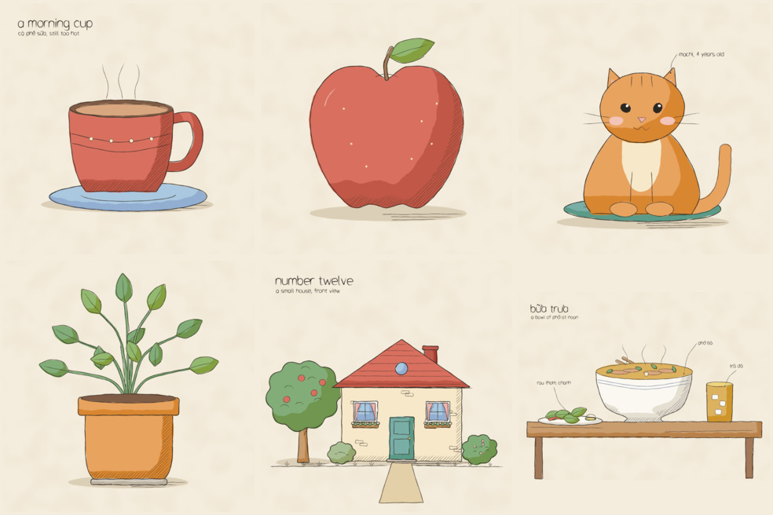
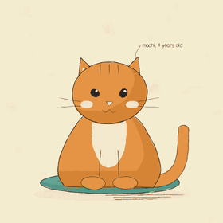

# handdrawn — a Claude Code skill for hand-drawn illustrations

Ask Claude for a picture ("a teapot", "a cat asleep on a windowsill", "một bát phở") and it draws it as one
self-contained SVG in an ink-and-marker look: wobbly lines of varying width, marker washes slightly
off-register on cream paper, flat 2D front or side view. PNG and small looping GIFs too.





## Install

```bash
cp -r handdrawn ~/.claude/skills/
cd ~/.claude/skills/handdrawn && npm install     # optional: only needed for PNG / GIF export
```

Requires Node 22.12+ (scene files are ES modules, detected automatically). SVG output has no dependencies; `@resvg/resvg-js` is the only (optional) dependency, used for
`--png`, `--thumb` and `--gif`.

## Use

In Claude Code:

> draw a cat asleep on a windowsill, with a small label

Claude lists the parts, blocks out the layout, writes a scene with the kit, renders it, **looks at the PNG**,
fixes what's off, and gives you the SVG and PNG. Ask for "an animated gif" to get a looping GIF.

By hand:

```bash
node handdrawn/assets/render.mjs handdrawn/examples/cat.js -o out/cat.svg --png out/cat.png
node handdrawn/assets/render.mjs handdrawn/examples/cup.js -o out/cup.svg --gif out/cup.gif
tests/verify.sh      # render all examples, check determinism + self-containment, build GIFs
```

## What's inside

```
handdrawn/
  SKILL.md              when to use, workflow, style rules
  assets/kit.js         the drawing kit (plain JS, no deps, Node + browser)
  assets/render.mjs     scene → SVG / PNG / thumbnail / GIF / animated SVG
  assets/gif.mjs        tiny GIF encoder (median-cut palette, ordered dither, LZW)
  examples/             cup, apple, cat, plant, house, meal
  references/kit.md     every kit function
tests/                  verify.sh + test sheets
```

How it looks hand-drawn: each ink line is a filled outline, not an SVG stroke. The kit resamples the path, has a
simulated hand follow it on a damped spring, overshoots the ends, adds a slow bow, a mid wobble and a fine tremor,
and varies the width with pressure. Washes are inset unevenly and shifted ~1–2 px off the ink, filled with a
flat colour. Every colour goes through `soften()` toward a warm marker palette. Text uses a built-in
single-stroke font (Latin + Vietnamese) drawn with the same ink. Same seed → byte-identical SVG.

## Licence

MIT, see [LICENSE](LICENSE). All code here is original. The visual style was inspired by looking at the
[Tinycharts](https://april-zhu.com/tinycharts) gallery; no Tinycharts code or assets were used.
