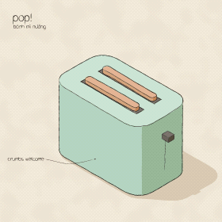

# handdrawn — Claude Code skills for hand-drawn illustrations

**Default look: 简笔画 + Q版.** Objects are drawn as 简笔画 (Chinese simple-stroke drawing): flat traditional
colours and a soft brush outline. People are Q版 (chibi): big heads, dot eyes, blush, and a thick even outline.
The classic ink-and-marker look below is `--theme classic`.

Ask Claude for a picture ("a teapot", "a cat asleep on a windowsill", "một bát phở") and it draws it in an
ink-and-marker look: wobbly lines of varying width, marker washes slightly off-register on cream paper. The
result is one self-contained **looping animated SVG** (frames switched by CSS, no script: it plays in browsers
and `` tags), plus a PNG still and, if you want, a GIF.

There are two skills:

| skill | what it draws | when Claude uses it |
|---|---|---|
| **`handdrawn`** | flat 2D, front or side view, like a children's-book or field-notebook sketch. The lines "boil" and the scene can add a small motion (steam, a swaying tail) | any ordinary "draw a …" request |
| **`handdrawn-3d`** | the subject modelled in 3D from simple solids, drawn isometric (or any camera angle) with flat light/mid/dark marker tones. Something in the object moves: a lid rattles, toast pops, sails turn | only when you ask for 3D / isometric, or call `/handdrawn-3d` |

### handdrawn (2D)


### handdrawn-3d




### Chinese vocab pictures

Ask for a picture of a Chinese word ("vẽ 苹果", "picture for 挥手") and the 2D skill draws it plain: one
subject, no setting, **no words** by default. Concrete words are stills. Actions loop the action itself, in
detail: a wave is an open five-finger hand swinging, framed waist-up. Abstract words (希望) get a word card
under the picture: characters, tone-coloured pinyin, Hán-Việt reading and the Vietnamese meaning. For
flashcards, `--card` also writes a picture+card face and a characters-only face.

Vocab pictures use the **Shēng** look by default (`--theme sheng`): flat #f7f6f2 paper, #191d24 ink, Pleco tone
colours on the pinyin, pinyin stacked above the hanzi. Ordinary drawings keep the classic cream paper
(`--theme sheng` works for those too).

Chinese styling comes from the subject and the line, not motifs. People default to black hair with a few real
hairstyles. Pieces draw everyday things as they look in China: a glass tea tumbler, a thermos, an enamel mug,
a rice bowl with chopsticks. The palette has traditional colour names (藤黄, 赭石, 花青, 黛, 月白, 青瓷).
`--stroke brush` gives a gongbi-style brush line.

`--theme jianbihua` (简笔画) is a flashcard set style: flat fills, a soft brush outline, a fixed set of traditional
colours, a transparent background and automatic framing, so every card in a set matches.

The design follows research on pictures in vocabulary learning: plain, unambiguous pictures (decoration and
ambiguity hurt), motion only where it carries the meaning (animation helps most for actions; Höffler & Leutner
2007), and the meaning available somewhere, because picture + meaning beats picture alone (Zhang, Sala & Gobet
2025).

## Install

```bash
cp -r handdrawn handdrawn-3d ~/.claude/skills/
(cd ~/.claude/skills/handdrawn && npm install)      # optional: only needed for PNG / GIF export
(cd ~/.claude/skills/handdrawn-3d && npm install)   # same for the 3D skill
```

Working on the skills themselves? Symlink instead of copying, so edits are live:
`ln -s "$PWD/handdrawn" "$PWD/handdrawn-3d" ~/.claude/skills/`.

Requires Node 22.12+ (scene files are ES modules, detected automatically). SVG output has no dependencies;
`@resvg/resvg-js` is the only (optional) dependency, used for `--png`, `--thumb`, `--strip` and `--gif`.

## Use

In Claude Code:

> draw a cat asleep on a windowsill, with a small label
>
> /handdrawn-3d a toaster popping

Claude lists the parts, writes a scene with the kit, renders it, **looks at the PNG** (and, in 3D, a strip of
frames across the loop), fixes what's off, and gives you the animated SVG and the PNG. Ask for a GIF when the
picture has to go somewhere that doesn't play SVG animation, or for "a still" to get a single frame.

By hand:

```bash
# 2D
node handdrawn/assets/render.mjs handdrawn/examples/cat.js -o out/cat.svg --png out/cat.png
node handdrawn/assets/render.mjs handdrawn/examples/cup.js -o out/cup.svg --gif out/cup.gif
node handdrawn/assets/render.mjs handdrawn/examples/apple.js -o out/apple.svg --still

# 3D
node handdrawn-3d/assets/render.mjs handdrawn-3d/examples/teapot.js -o out/teapot.svg --png --strip

tests/verify.sh      # render all examples of both skills, check determinism + self-containment, build GIFs
```

## What's inside

```
handdrawn/                  2D skill
  SKILL.md                  when to use, workflow, style rules
  assets/kit.js             the drawing kit (plain JS, no deps, Node + browser)
  assets/render.mjs         scene → animated SVG / PNG / thumbnail / GIF
  assets/gif.mjs            tiny GIF encoder (median-cut palette, ordered dither, LZW)
  examples/                 cup, apple, cat, plant, house, meal
  references/kit.md         every kit function
handdrawn-3d/               3D skill (same layout)
  assets/kit.js             the 2D kit's ink, wash and font + a 3D layer: camera, solids, shading, sorting
  assets/render.mjs         also measures every frame for stable framing; --strip for a contact sheet
  examples/                 cup, teapot, toaster, windmill
tests/                      verify.sh + test sheets
```

**How it looks hand-drawn:** each ink line is a filled outline, not an SVG stroke. The kit resamples the path,
has a simulated hand follow it on a damped spring, overshoots the ends, adds a slow bow, a mid wobble and a fine
tremor, and varies the width with pressure. Washes are inset unevenly and shifted ~1–2 px off the ink, filled
with a flat colour. Every colour goes through `soften()` toward a warm marker palette. Text uses a built-in
single-stroke font (Latin + Vietnamese) drawn with the same ink. Same seed → byte-identical SVG. In the animation,
the wobble is redrawn every 2 frames ("on twos"), so even a still subject looks alive.

**How the 3D works:** there is no 3D library and no depth buffer. A scene is built from a few solids (`box`,
`cylinder`, `lathe`, `sphere`, `extrude`, `tube`, `panel`) seen through an orthographic camera (isometric by
default). Each face gets one of three flat tones from a light fixed at the viewer's upper left. Neighbouring faces
of the same tone merge into one marker wash, with the band edges smoothed. The silhouette is inked heavy and the
sharp creases lighter. Solids are sorted back to front against each other. A few rules keep that right:
- contents of a container (`in:`) go between its inside and its outside
- decals (`on:`) stay with their face
- tubes are cut where they enter a body
- something standing on another solid casts its shadow onto it

The scene is drawn once per frame with `t` going round one loop. Every frame is measured first, so moving parts
never make the framing jump.

## Licence

MIT, see [LICENSE](LICENSE). All code here is original. The 2D visual style was inspired by looking at the
[Tinycharts](https://april-zhu.com/tinycharts) gallery. The 3D approach (orthographic camera, three flat tones by
face normal, painter's sorting of separate solids) was studied from [Colorfigures](https://april-zhu.com/colorfigures)
by April Zhu (MIT). No Tinycharts or Colorfigures code or assets were used.
