# handdrawn — Claude Code skills for hand-drawn illustrations

Ask Claude for a picture ("a teapot", "a kid drinking water", "một bát phở") and it draws it. The result is one
self-contained **looping animated SVG** (frames switched by CSS, no script: it plays in browsers and `` tags),
plus a PNG still and, if you want, a GIF.

**One look, two skills.** Both draw in the same default style, **简笔画 + Q版**, and everything is Q版: objects as
简笔画 (Chinese simple-stroke drawing) with flat traditional colours, squat chunky shapes, rounded corners and one
thick even outline (no faces on objects); people and animals as Q版: big
heads, dot eyes, blush. Same palette, same ink, same Q版 characters in 2D and 3D, so pictures from either sit side by side.
The original ink-and-marker look on cream paper is `--theme classic` in both.

| skill | what it draws | when Claude uses it |
|---|---|---|
| **`handdrawn`** | flat 2D, front or side view | the default: vocab cards, faces, expressions, gestures, animals, plants, food, objects, and also buildings, rooms, furniture and vehicles |
| **`handdrawn-3d`** | the subject modelled in 3D from simple solids, any camera angle, soft light/dark tones | when you ask for 3D / isometric (or `/handdrawn-3d`), or when the **motion itself moves in depth**: a person bringing something to the face (drinking, eating), a drawer sliding out toward you, a door swinging open toward you |

Both skills carry the same ordered **"2D or 3D?"** rule in their descriptions, so Claude picks one and says so.

## Demo: the same eight prompts, 2D and 3D

Rendered with `bash docs/demo/build.sh` (default look, on paper). Click a picture for the animated SVG.

| prompt | `handdrawn` (2D) | `handdrawn-3d` |
|---|---|---|
| a cup of coffee on a saucer, steaming | [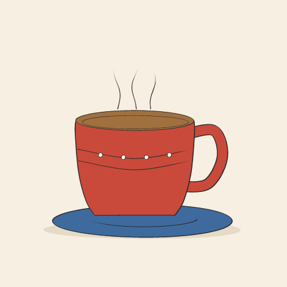](docs/demo/2d-cup.svg) | [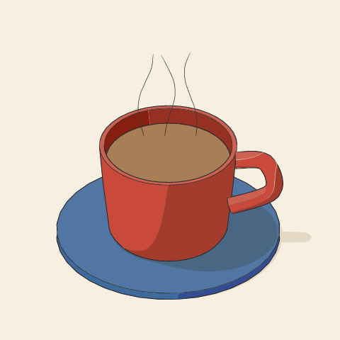](docs/demo/3d-cup.svg) |
| an apple with a leaf | [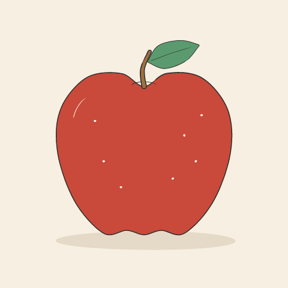](docs/demo/2d-apple.svg) | [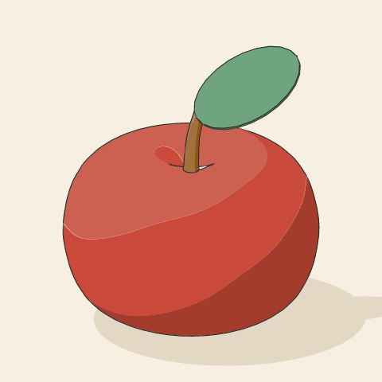](docs/demo/3d-apple.svg) |
| a leafy plant in a pot | [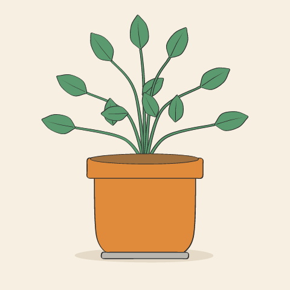](docs/demo/2d-plant.svg) | [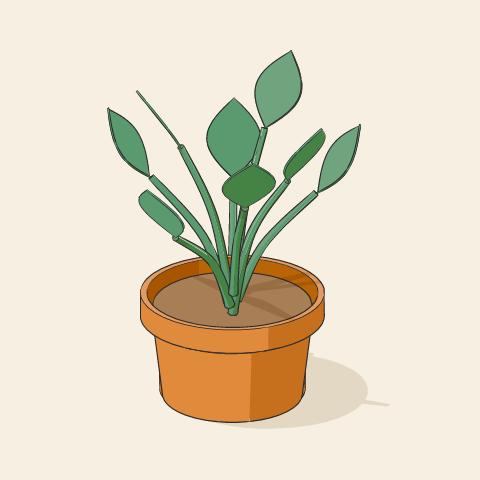](docs/demo/3d-plant.svg) |
| a small house with a tree | [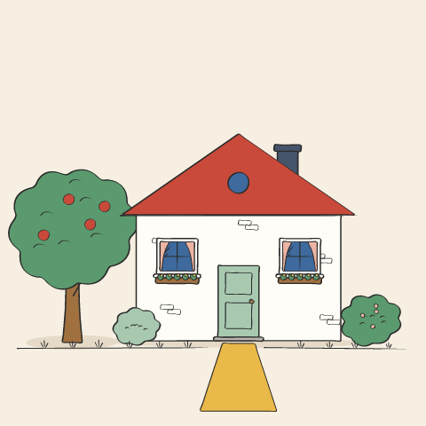](docs/demo/2d-house.svg) | [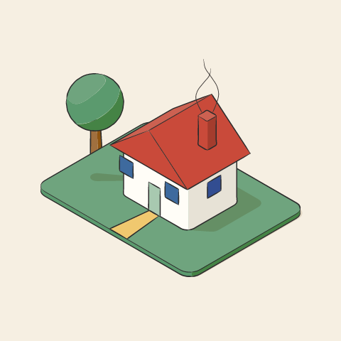](docs/demo/3d-house.svg) |
| a cat sitting on a cushion | [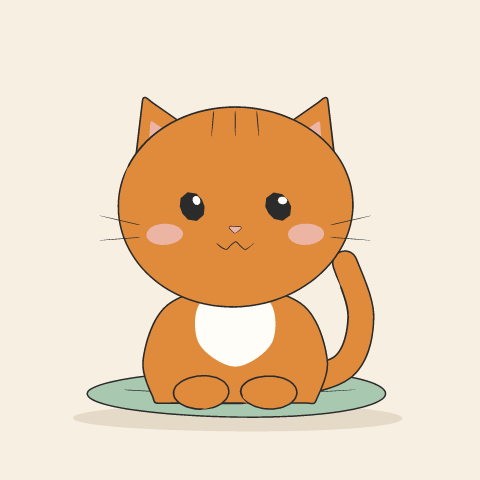](docs/demo/2d-cat.svg) | [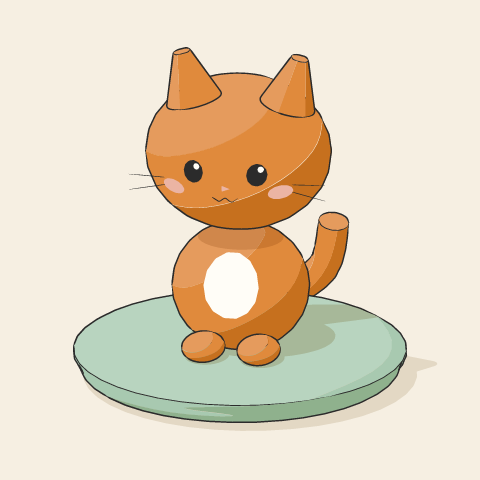](docs/demo/3d-cat.svg) |
| a kid drinking a glass of water | [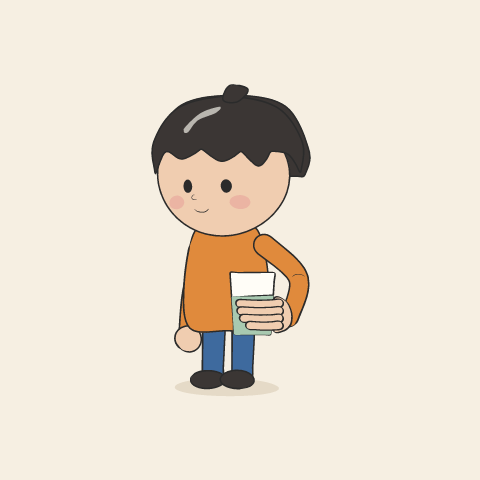](docs/demo/2d-drink.svg) | [](docs/demo/3d-drink.svg) |
| lựa chọn (选择, abstract) | [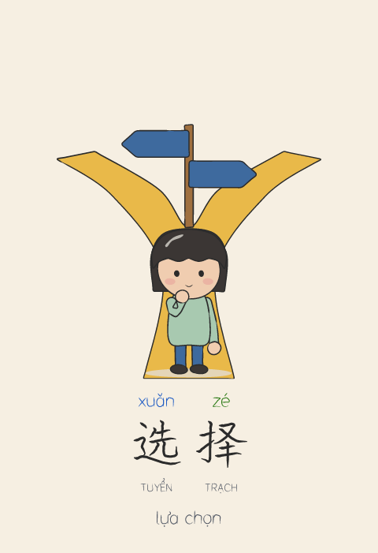](docs/demo/2d-choose.svg) | [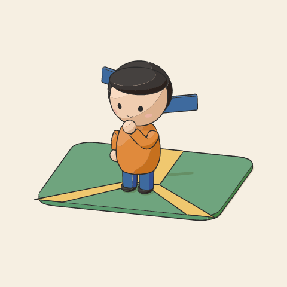](docs/demo/3d-choose.svg) |
| kỷ luật (纪律, abstract) | [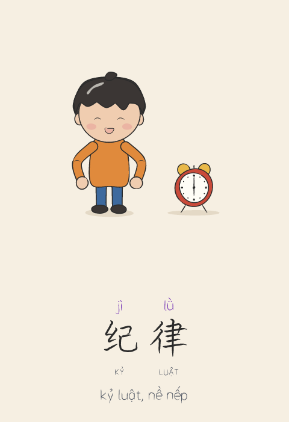](docs/demo/2d-discipline.svg) | [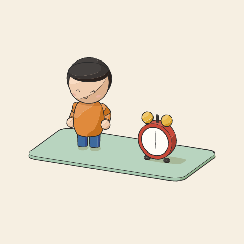](docs/demo/3d-discipline.svg) |

Abstract words are vocab cards in 2D (picture + characters, pinyin, Hán-Việt, meaning); 3D draws the same
metaphor as a scene. **Which one wins:** 2D for seven of the eight. Volume alone isn't a reason for 3D (the
house and the cat read best flat). 3D wins only for the drinking kid, where the motion goes in depth. The glass comes *toward* the face, which 2D can only fake (the glass slides
across the cheek); in 3D the arm, glass and head share one space and line up by construction.

### The classic look (`--theme classic`)

Wobbly lines of varying width and marker washes slightly off-register on cream paper.


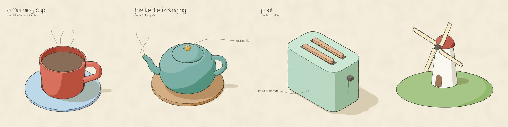

## Motion that feels physical, without a video model

Video models (Flow, Veo) get physical motion for free because they learned it, but they cost a lot per clip. Here
every frame is computed, so the physics is written into the kit:

- **Keyframe the cause, simulate the effect.** Only the main motion gets beats (`k.motion`). Everything it drags
  along uses `k.follow`: second-order dynamics (a mass on a spring, after t3ssel8r's *Giving Personality to
  Procedural Animations using Math*), simulated over a few warm-up loops and cached, so it loops seamlessly. A head
  tips back a beat after the glass; leaves and a tree crown swing after the breeze and settle.
- **Water** keeps its volume and a level surface in a tipping glass. "Up" for the water is gravity minus the
  glass's acceleration (`k.accel`), passed through a spring, so it sloshes and rings out.
- **Arms** are a two-bone IK solved in 3D with a fixed pole vector, then projected (2D) or drawn (3D): bones keep
  their length, the elbow never flips, and the arm foreshortens when the hand passes in front of the shoulder.
- **Paper stop-motion** reveals (`k.pop`, `k.drop`) treat parts as rigid cut-outs that slide, fall and bounce.

### Chinese vocab pictures

Ask for a picture of a Chinese word ("vẽ 苹果", "picture for 挥手") and the 2D skill draws it plain: one
subject, no setting, **no words** by default. Concrete words are stills. Actions loop the action itself, in
detail: a wave is an open five-finger hand swinging, framed waist-up. Abstract words (希望) get a word card
under the picture: characters, tone-coloured pinyin, Hán-Việt reading and the Vietnamese meaning. For
flashcards, `--card` also writes a picture+card face and a characters-only face.

Vocab pictures use the default 简笔画 + Q版 look. `--theme sheng` gives the Shēng design-system look: flat
#f7f6f2 paper, #191d24 ink, Pleco tone colours on the pinyin, pinyin stacked above the hanzi.

Chinese styling comes from the subject and the line, not motifs. People default to black hair with a few real
hairstyles. Pieces draw everyday things as they look in China: a glass tea tumbler, a thermos, an enamel mug,
a rice bowl with chopsticks. The palette has traditional colour names (藤黄, 赭石, 花青, 黛, 月白, 青瓷).
`--stroke brush` gives a gongbi-style brush line.

The default `jianbihua` (简笔画) theme is built for flashcard sets: flat fills, a soft brush outline, a fixed set
of traditional colours, a transparent background (`--opaque` for paper) and automatic framing, so every card in a
set matches.

The design follows research on pictures in vocabulary learning: plain, unambiguous pictures (decoration and
ambiguity hurt), motion only where it carries the meaning (animation helps most for actions; Höffler & Leutner
2007), and the meaning available somewhere, because picture + meaning beats picture alone (Zhang, Sala & Gobet
2025).

## Install

```bash
cp -r handdrawn handdrawn-3d ~/.claude/skills/
(cd ~/.claude/skills/handdrawn && npm install)      # optional: only needed for PNG / GIF export
(cd ~/.claude/skills/handdrawn-3d && npm install)   # same for the 3D skill
```

Working on the skills themselves? Symlink instead of copying, so edits are live:
`ln -s "$PWD/handdrawn" "$PWD/handdrawn-3d" ~/.claude/skills/`.

Requires Node 22.12+ (scene files are ES modules, detected automatically). SVG output has no dependencies;
`@resvg/resvg-js` is the only (optional) dependency, used for `--png`, `--thumb`, `--strip` and `--gif`.

## Use

In Claude Code:

> draw a cat asleep on a windowsill
>
> a kid drinking a glass of water, in 3D
>
> /handdrawn-3d a toaster popping

Claude lists the parts, writes a scene with the kit, renders it, **looks at the PNG** (and, in 3D, a strip of
frames across the loop), fixes what's off, and gives you the animated SVG and the PNG. Ask for a GIF when the
picture has to go somewhere that doesn't play SVG animation, or for "a still" to get a single frame.

By hand:

```bash
# 2D
node handdrawn/assets/render.mjs handdrawn/examples/cat.js -o out/cat.svg --png out/cat.png
node handdrawn/assets/render.mjs handdrawn/examples/cup.js -o out/cup.svg --gif out/cup.gif
node handdrawn/assets/render.mjs handdrawn/examples/apple.js -o out/apple.svg --still

# 3D
node handdrawn-3d/assets/render.mjs handdrawn-3d/examples/drink.js -o out/drink.svg --png --strip
node handdrawn-3d/assets/render.mjs handdrawn-3d/examples/teapot.js -o out/teapot.svg --theme classic   # the original look

tests/verify.sh      # render all examples of both skills, check determinism + self-containment, build GIFs
bash docs/demo/build.sh   # re-render the 2D vs 3D demo above
```

## What's inside

```
handdrawn/                  2D skill
  SKILL.md                  when to use, workflow, style rules
  assets/kit.js             the drawing kit (plain JS, no deps, Node + browser)
  assets/render.mjs         scene → animated SVG / PNG / thumbnail / GIF
  assets/gif.mjs            tiny GIF encoder (median-cut palette, ordered dither, LZW)
  examples/                 cup, apple, cat, plant, house, meal, vocab-* (Chinese words; vocab-drink = physics,
                            vocab-discipline = 纪律)
  references/kit.md         every kit function
handdrawn-3d/               3D skill (same layout)
  assets/kit.js             the 2D kit's ink, wash, font and themes + a 3D layer: camera, solids, shading,
                            sorting, k.chibi, k.mesh, k.follow
  assets/render.mjs         also measures every frame for stable framing; --strip for a contact sheet
  examples/                 cup, apple, plant, house, cat, teapot, toaster, windmill, drink (Q版 person + IK +
                            water), choose, discipline
docs/demo/                  the 2D vs 3D demo: scenes/, build.sh, rendered SVG + PNG
tests/                      verify.sh + test sheets
```

**How it looks hand-drawn:** each ink line is a filled outline, not an SVG stroke. The kit resamples the path,
has a simulated hand follow it on a damped spring, overshoots the ends, adds a slow bow, a mid wobble and a fine
tremor, and varies the width with pressure. Washes are inset unevenly and shifted ~1–2 px off the ink, filled
with a flat colour. Every colour goes through `soften()` toward a warm marker palette. Text uses a built-in
single-stroke font (Latin + Vietnamese) drawn with the same ink. Same seed → byte-identical SVG. In the animation,
the wobble is redrawn every 2 frames ("on twos"), so even a still subject looks alive.

**How the 3D works:** there is no 3D library and no depth buffer. A scene is built from a few solids (`box`,
`cylinder`, `lathe`, `sphere`, `extrude`, `tube`, `panel`) seen through an orthographic camera (isometric by
default). Each face gets one of three flat tones from a light fixed at the viewer's upper left. Neighbouring faces
of the same tone merge into one marker wash, with the band edges smoothed. The silhouette is inked heavy and the
sharp creases lighter. Solids are sorted back to front against each other. A few rules keep that right:
- contents of a container (`in:`) go between its inside and its outside
- decals (`on:`) stay with their face
- tubes are cut where they enter a body
- something standing on another solid casts its shadow onto it

The scene is drawn once per frame with `t` going round one loop. Every frame is measured first, so moving parts
never make the framing jump.

## Licence

MIT, see [LICENSE](LICENSE). All code here is original. The 2D visual style was inspired by looking at the
[Tinycharts](https://april-zhu.com/tinycharts) gallery. The 3D approach (orthographic camera, three flat tones by
face normal, painter's sorting of separate solids) was studied from [Colorfigures](https://april-zhu.com/colorfigures)
by April Zhu (MIT). No Tinycharts or Colorfigures code or assets were used.
